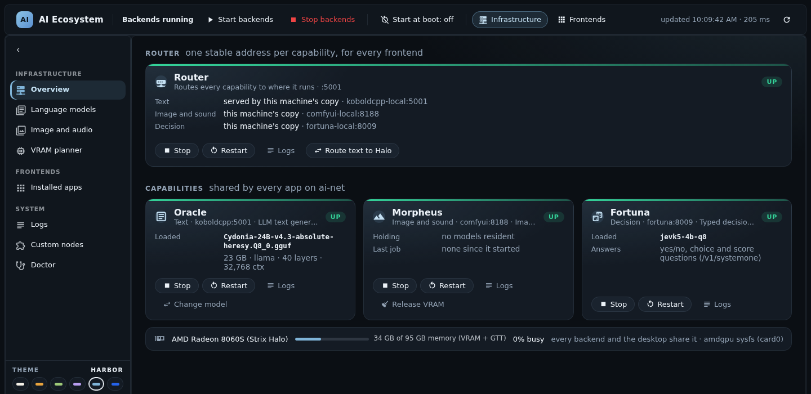

# AI Ecosystem

**AI Ecosystem** is a local, self-hosted AI stack: shared GPU **backends** for text, image and
sound, and decisions, behind one **router**; the **frontends** that use them; and a dashboard for
all of it. One command, `stack`, drives everything. Bring the backends up once, then use whichever
apps you want.

**Names:** AI Ecosystem is the product's name, what you see and what the docs call it. The repo
is `ai-stack` (`JotunheimPress/ai-stack`), the command is `stack`, and the dashboard's service key
is `stackui`. Those are what you type, and they don't change with the brand.

**Version:** see [`VERSION`](VERSION) and the [changelog](CHANGELOG.md); `stack version` prints
the one you have.

**Documentation:** the [wiki](https://github.com/JotunheimPress/ai-stack/wiki) has the full user
guide (install, running, the dashboard, models, frontends, troubleshooting) and a developer guide.
Its source is [`docs/wiki/`](docs/wiki/README.md), published with `docs/publish-wiki.sh`.



## What's in it

**Backends** (shared by every app; all Podman containers on the `ai-net` network)

| Capability | Backend | Name on `ai-net` | On this machine |
|---|---|---|---|
| Text | **KoboldCPP** (GGUF models) | `http://koboldcpp:5001` | `localhost:5001` |
| Image and sound | **ComfyUI** | `http://comfyui:8188` | `localhost:8188` (8189 where `host.env` sets `COMFYUI_PORT`) |
| Decisions | **Fortuna**: yes/no, choice and score answers as calibrated probabilities | `http://fortuna:8009` | `127.0.0.1:8009` |

Every request goes through the **router** (nginx), which owns those names and ports. Frontends
never need to know which copy serves them, and text can be moved to another machine with
`stack route` without changing anything else.

**Frontends** are separate repos, each with a `frontend.json`; the stack discovers whichever are
cloned next to it (`stack frontends` lists them). Today's set includes Whimsy (`companion`, 7861),
the Narrative Engine (`ai-story-maker`, 7860), Iguana Studio (7862), Nocturne (7864), the
`npc_maker` and `narrative_engine` forks (7865, 7866) and Cantinero (`companion-assistant`, 7867).

**The AI Ecosystem dashboard** (`stack-ui/`, port 7863) is the control panel: start and stop, start at
boot, what each backend has loaded, model downloads and selection (HuggingFace, Civitai,
Fortuna's pinned files), the VRAM planner, logs, the doctor, and six colour themes.

## Requirements

- **Podman** (rootless).
- A GPU, detected automatically (pin it in `host.env`, from `host.env.example`):
  - **NVIDIA** with the container toolkit: `nvidia-smi` works and `nvidia-ctk cdi list` shows
    `nvidia.com/gpu=all`. The reference machine is an RTX 4070 (12 GB).
  - **AMD** Strix Halo (gfx1151, 128 GB unified memory), on Vulkan or ROCm: `/dev/kfd`,
    `/dev/dri`, and your user in `render` and `video`. See [`HALO_PLAN.md`](HALO_PLAN.md).
- **git** and **curl**.

`stack doctor` checks all of it.

## Install

```bash
git clone https://github.com/JotunheimPress/ai-stack.git
cd ai-stack
./stack install          # idempotent: safe to re-run any time
```

`stack install` checks prerequisites, puts `stack` on your PATH, installs the systemd unit for
this checkout, creates `ai-net`, builds the backend images and the dashboard, lays out
`koboldcpp/` and `ComfyUI/` next to the checkout, and clones the pinned ComfyUI custom nodes.
Targets: `all` (default), `backends`, `router`, `koboldcpp`, `comfyui`, `fortuna`, `stackui`,
`service`, `path`.

**It never downloads model weights.** A fresh install ends with *"install done, N item(s) need
you"* and says what's missing: a GGUF for KoboldCPP, a checkpoint for ComfyUI, a model file for
Fortuna. Get them from the dashboard's model screens, `stack fortuna-model fetch NAME`, or by hand
([`koboldcpp/INSTALL.md`](koboldcpp/INSTALL.md) §2, [`comfyui/INSTALL.md`](comfyui/INSTALL.md) §8).
Then:

```bash
stack doctor        # read-only check of everything
stack on            # start the backends now
stack boot on       # optional: also start them at every boot (+ loginctl enable-linger)
stack stackui       # the dashboard: http://localhost:7863
```

The dashboard reaches the host's podman through your user's socket:
`systemctl --user enable --now podman.socket`.

### Updating

```bash
cd ai-stack
git pull --ff-only
stack install       # rebuilds whatever changed, the dashboard included
stack version       # the release you now have
```

[`CHANGELOG.md`](CHANGELOG.md) says what each release changed, and whether anything outside the
repo (a frontend, a script reading `stack status --json`) needs a change too.

### Frontends

Clone the ones you want into the same parent directory as `ai-stack/`, then start one by its
repo name, e.g. `stack iguana_studio`. Each builds its own image on its first start; see its own
README. They are private repos; ask for access.

```bash
cd ..
git clone https://github.com/JotunheimPress/iguana_studio.git
git clone https://github.com/JotunheimPress/nocturne.git
git clone https://github.com/JotunheimPress/muninn.git    # memory library some frontends build against
```

## Usage

```bash
stack on | off           # start / stop the backends now (never changes start at boot)
stack boot [on|off]      # start at boot: show / set (never starts or stops anything now)
stack                    # interactive: status, start the backends, pick a frontend
stack status             # what's up, and whether the backends start at boot
stack <app>              # start one app: a backend, stackui, or a frontend by repo name
stack restart <app>
stack logs <app>
stack down               # stop everything except the dashboard (also: down backends | frontends | <app>)
stack frontends          # the installed frontends
stack route [local|halo] # where text is served
stack fortuna-model [list | fetch NAME | verify NAME]
stack install [target]
stack doctor
stack version            # the AI Ecosystem release and this checkout's commit
```

**To free the GPU for a game:** `stack off`, plus `stack boot off` if it should stay off after a
reboot.

## On the LAN

Every app answers on the whole local network over plain HTTP at `http://<hostname>.local:<port>`,
including the dashboard on `:7863`. **The dashboard has no login**, so anyone on your network
can drive the stack. Browsers allow the microphone only on this computer or over HTTPS; frontends
that need it from a phone offer an HTTPS port (see [Frontends](docs/wiki/frontends.md)).

## Layout

```
ai_ecosystem/            # the ecosystem root ($AI_ECOSYSTEM, else this checkout's parent)
├── ai-stack/            # this repo: stack, the recipes, the dashboard
├── koboldcpp/           # made by stack install: links into ai-stack/koboldcpp + your models/
├── ComfyUI/             # ComfyUI's state: models, input, output, user, custom_nodes
├── fortuna/             # Fortuna's models/ and fortuna.env
├── router/              # route.conf: where text goes
└── <frontends>/         # the frontends you cloned
```

Recipes (Containerfiles, start scripts, configs) live in this repo; state lives in the sibling
directories and is never committed. More in the wiki's [Architecture](docs/wiki/architecture.md)
page and in [`CLAUDE.md`](CLAUDE.md).
